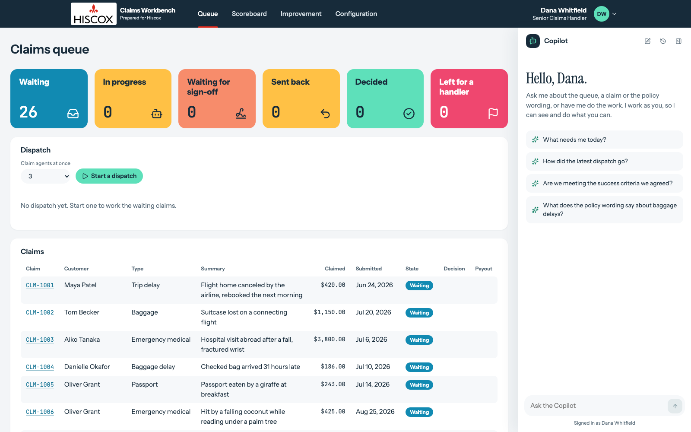
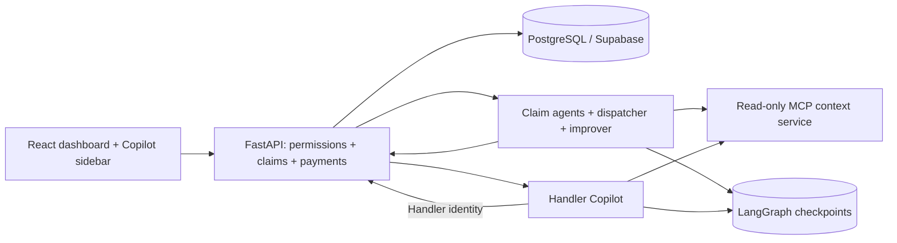

# Claims Workbench

[](https://github.com/8ehrad/claims-workbench/actions/workflows/check.yml)

An independent insurance claims platform with durable AI agents, human approval and an auditable handler copilot. Built as a portfolio demonstration by **Behrad Zabihi**.

The demo uses synthetic travel claims and illustrative policy wording. It is not affiliated with an insurer, makes no real payments and does not represent an insurer's underwriting rules.

The website uses Hiscox's official logo and a **Prepared for Hiscox** caption. The repository and underlying application remain Claims Workbench.



## What it demonstrates

- **Durable claim processing:** a LangGraph claim agent resumes from saved progress after interruption, with replay-safe decision and payment operations.
- **Human control:** a configurable approval threshold holds large payouts. A senior handler signs off or sends the decision back with a review note.
- **Grounded decisions:** read-only MCP tools retrieve policy sections, handling rules and reference data with source attribution. Payout arithmetic and decision validation run in code.
- **Security boundaries:** a separate screening model checks customer text before the claim agent sees it. Handler JWTs and the agent API key have distinct permissions.
- **Measured improvement:** evaluations use isolated claim copies; changes are versioned, human-reviewed and kept or rolled back against held-out objectives.
- **Handler copilot:** conversation history, live tool cards and confirmation before a held payment. It acts with the requesting handler's permissions.

## Architecture



The backend owns business rules and the system of record. Models select evidence and propose decisions; they cannot bypass the payout calculation, approval threshold or handler permissions. Optional AgentCore Gateway and Memory integrations are included.

## Run locally

Requires Python 3.12, uv and Node 26. The backend supports SQLite, but live agents require PostgreSQL for checkpoints. Supabase provides sign-in; create a separate demo project rather than connecting this to business data.

```sh
uv sync --locked
npm ci
```

Copy `.env.example` to `.env` (`cp .env.example .env` on macOS/Linux; `Copy-Item .env.example .env` in PowerShell), then supply the database, Supabase and OpenRouter values. Set `CLAIMS_API_KEY` to a random secret, for example from `uv run python -c "import secrets; print(secrets.token_urlsafe(32))"`.

Create Supabase Auth users matching the synthetic handlers:

| Email | Role |
| --- | --- |
| `dana.whitfield@claims-demo.example` | Senior handler; sign-off, settings and improvement approval |
| `marcus.oyelaran@claims-demo.example` | Handler; no over-limit sign-off |
| `priya.raman@claims-demo.example` | Handler; no over-limit sign-off |

Use passwords you set yourself; this repository contains no live credentials. `HANDLER_PASSWORD` is only for manual browser verification and does not create Auth users.

If you already have Supabase accounts with different emails, keep those accounts and passwords. Map them to the demo handler ids in your local `.env`, for example `CLAIMS_HANDLER_EMAILS='{"HND-01":"senior@example.com"}'`, then run `npm run configure:handlers` against an already seeded database. This changes only the configured handlers' email addresses and preserves claims, decisions and roles. Future seeds respect the same mapping. Sign-in still requires the account's valid Supabase token; matching a display name alone never grants access.

```sh
npm run seed
npm run dev
```

Seeding **replaces this application's database tables** with the synthetic dataset. The isolated `claims_workbench` schema contains 26 queue claims, 51 policies and 50 customers, plus evaluation records. Use a dedicated database.

Open `http://localhost:5173`. Development services: backend 8000, claim agent 8080, Copilot 8081 and context MCP 8006. To process just one claim: `uv run --env-file .env -m agent CLM-1001`.

## Verification

```sh
npm run check
npm run build
```

The full check runs Ruff, Pyright, pytest, isolated deployment dependency imports, ESLint, Prettier, TypeScript, Vitest and Playwright. Tests use temporary SQLite databases, stub models and local service stand-ins; they do not need `.env`, cloud credentials or paid model calls. Python and frontend coverage gates are 80%.

See [verification results](docs/VERIFICATION.md), [deployment](docs/DEPLOYMENT.md), [architecture and limitations](docs/ARCHITECTURE.md) and the [five-minute walkthrough](docs/WALKTHROUGH.md). Source attribution is in [NOTICE.md](NOTICE.md).
